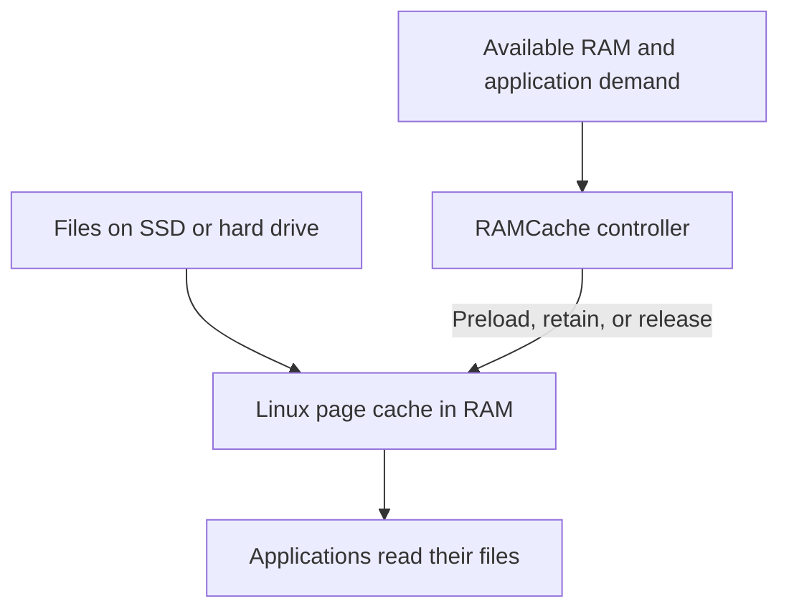
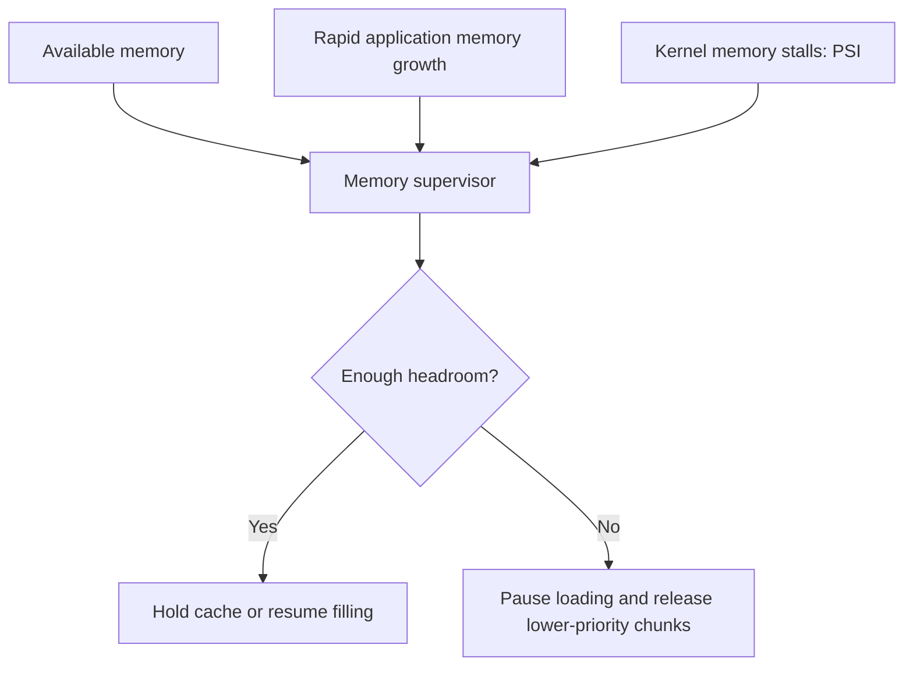

<div align="center">

# ◈ RAMCACHE

### Faster application launches, powered by spare RAM.

**Preemptive · Dynamic · Automatic**


<br>

[Install / update](#install-and-update) ·
[Uninstall](#uninstall) ·
[Status](#status) ·
[How it works](#how-it-works) ·
[Configuration](#configuration)

</div>

**RAMCache uses spare RAM to make opening applications and using your Linux desktop faster. It is free, open-source, and runs automatically.**

Opening an application means fetching its program files, shared components, settings, and other data. Even a fast SSD takes time to answer each request. When an application needs lots of small pieces of data, those waits add up.

**RAM is much quicker to access than an SSD. Even DDR4 RAM responds far sooner than a Gen5 NVMe drive.** RAMCache takes advantage of that difference by reading selected files ahead of time and keeping them in RAM. When you click the application, Linux already has those files in memory and serves them without going back to the drive.

This also helps the first application launch after boot once the relevant files have been preloaded. You do not have to open an application once to prepare the cache.

RAMCache works with Linux's existing file cache. It chooses useful files, adjusts its memory use automatically, and releases memory when applications need more room. Your files stay in their original locations.

With **16 GB of RAM**, it concentrates on a smaller selection of useful desktop and application files. With **32 GB or more**, more files fit in the cache together, extending the benefit across more of your everyday work.

Supports common systemd-based distributions, including Linux Mint, Ubuntu, Pop!_OS, Debian, Fedora, Arch/CachyOS, and openSUSE.

## Privacy

**RAMCache does not phone home.** It has no telemetry, analytics, or background uploads. Caching and usage learning run entirely on your computer and work without an internet connection.

To choose useful files, RAMCache keeps local records of file paths, sizes, timestamps, application identifiers, and usage counts. These records stay on your computer. File names, application activity, and cached contents are never uploaded to the developer or any external service.

Usage learning does not inspect file contents or browser URLs. Its saved inventory and learned state live under `/var/lib/ramcache-controller/` and are removed when you uninstall RAMCache.

## Get started

### Install and update

```bash
curl -fsSL https://raw.githubusercontent.com/MagnetosphereLabs/RamCache/main/ramcache.sh | sudo bash -s install
```

Installs dependencies, configures the service, enables it at boot, and starts it immediately.

**Run the same command to update.** Custom configuration and saved state are retained. Missing settings are added, and configuration changes are validated and backed up before replacement.

### Uninstall

```bash
curl -fsSL https://raw.githubusercontent.com/MagnetosphereLabs/RamCache/main/ramcache.sh | sudo bash -s uninstall
```

Stops the service and removes RAMCache, its configuration, saved inventory, learned usage, and runtime state. Your application files stay where they are. Installed dependency packages are left in place.

### Status

```bash
curl -fsSL https://raw.githubusercontent.com/MagnetosphereLabs/RamCache/main/ramcache.sh | bash -s status
```

Shows the service state, cache size, available memory, loading progress, and current activity. This is a read-only check.

## Everyday use

An SSD's large-file transfer speed tells only part of the story. Opening an application often involves many smaller reads from different places. The application keeps asking for more pieces as it starts, and the time spent waiting for those requests affects how quickly it opens.

RAMCache does selected reading before you click. Files that would otherwise need a trip to the drive are already in RAM. The application still performs its normal startup work, but it spends less time waiting for those files.

Preloading reads files into memory. It does not launch the applications in the background.

| What you do | How RAMCache helps |
| :---: | :--- |
| **Open applications** | Preloads selected program files and shared components. Linux reads those files from RAM during startup, helping applications open sooner. |
| **Use menus, settings, and file pickers** | Preloads useful interface files, fonts, icons, and desktop resources. Opening these parts of the desktop involves fewer reads from the drive. |
| **Start and use a browser** | Preloads selected browser files, extensions, profile data, and cached code. The browser spends less time fetching local files as it starts and uses that data. |
| **Use Steam and selected games** | Preloads Steam client files, selected Proton runtimes, shaders, and startup dependencies. Those files are ready when the launcher or supported startup paths need them. |

Selected data stays cached across launches and other disk activity while memory allows. When another workload needs more RAM, the controller releases lower-priority data first.

### What more RAM changes

A **16 GB desktop** still has useful opportunities for caching. Desktop resources and selected application files take much less space than entire installations. RAMCache uses a more conservative profile on these systems, leaving room for the applications themselves.

With **32 GB or more**, there is more room for running applications and a larger cache at the same time. Desktop files, browser data, Steam, and other useful application files fit together more readily. You get the benefit across more tasks because more of the files they need remain in memory.

The amount of spare RAM matters as well as the total installed. RAMCache adjusts around what the computer is doing instead of permanently setting aside a fixed amount.

### Where the benefit comes from

RAMCache reduces the time spent fetching files. It does not speed up CPU calculations, graphics rendering, or network requests. For games, it targets useful launch and startup data within the available memory rather than expecting a typical desktop to hold an entire 100 GB installation.

I use RAMCache every day on my 2021 system. Another tester reported a substantial improvement on an already fast Linux Mint desktop with 32 GB of RAM. The size of the improvement depends on the workload, storage, and spare memory.

## How it works

Linux already keeps file data in RAM through its **page cache** and reads ahead when appropriate. Cached reads are fast, but useful files may be absent when an application starts or may have been reclaimed during other work.

RAMCache adds three decisions to that existing system: **which files to load early, which pages to retain, and when to release them.**



It loads selected files into the normal page cache and uses `vmtouch` with `mlock()` to keep their pages resident. Locking prevents ordinary cache reclamation from removing those selected pages while RAMCache retains them.

Applications continue reading the same files through Linux. There is no duplicate RAM filesystem, application relocation, or kernel replacement.

When RAMCache releases a lock, Linux is free to reclaim those pages. Data that remains in the normal cache still serves later reads.

### Discover useful files

The controller discovers native applications, Flatpak and Snap installations, browser profiles, desktop resources, Steam libraries, and common runtime locations.

Discovery accounts for different installation layouts, user homes, separate filesystems, and Steam libraries listed in `libraryfolders.vdf`. Overlapping roots and files sharing the same device and inode are deduplicated so the same underlying data is not loaded twice.

Scans skip symlinks, special files, excluded paths, and known low-value directory trees. Application and runtime locations are examined early, allowing useful loading to begin while broader discovery continues.

### Select before launch, refine through use

Built-in file policies provide the initial selection. RAMCache recognizes program code, core libraries, desktop dependencies, startup state, and useful caches before it has learned your application habits.

Usage learning then refines later selections. The controller observes application file opens and mapped executables and libraries, including activity that already hits the page cache. Useful activity still counts when the files are already in RAM.

Fanotify supplies file-open notifications where available. Process-map learning provides another source and remains available when file-open learning cannot be used.

Observations are grouped into five-minute buckets, and usage loses weight with a 14-day half-life. Repeated opens in a short burst do not each add another usage increment, and old habits gradually lose influence.

Each selection remains subject to file policy and memory budgets. Large media, installation archives, diagnostic logs, container storage, and unrelated game payloads are excluded or ranked behind more useful data.

Learning records file metadata and application identity. It does not inspect browser URLs or read file contents.

<details>
<summary><strong>Desktop and application policies</strong></summary>

RAMCache distinguishes useful resources within an application, including database journals that might otherwise look like ordinary logs.

| Area | Recognized data |
| :---: | :--- |
| **Desktop environments** | COSMIC, GNOME, KDE Plasma, Cinnamon, MATE, Xfce, Hyprland, Sway, and Niri resources; GTK/Qt modules; extensions; themes; graphics and audio dependencies |
| **Browsers** | Firefox, LibreWolf, Zen, Floorp, Waterfox, and Chromium-family profiles; extensions; startup and compiled-code caches; indexes; session and site databases; bounded HTTP and shader caches |
| **Electron applications** | Discord, Vesktop, VS Code/VSCodium, and other recognized layouts, including OBS browser-plugin state |
| **Steam** | Client UI, `steamwebhelper`/CEF resources, manifests, configuration, profile state, selected Proton tools, and required Steam Linux Runtime dependencies |
| **VRChat** | Executables, DLLs, Unity startup files, Proton state, selected shaders, and recent complete world/avatar cache objects |
| **War Robots** | Recognized executable, Unity startup, Proton, and shader data |
| **Hytale** | Launcher, client, server, Java runtime, and bounded world/save data |

Steam startup metadata selects up to three configured/current Proton tools and the Steam Linux Runtime dependencies they require. This keeps the startup selection focused on useful tools rather than every installed Proton version.

VRChat recognizes standard cache locations and an explicitly configured `cache_directory`, including its Wine drive mapping. Unity payloads and their matching information files are selected as complete version groups, ordered by payload modification time. Downloaded content files of 1 GiB or larger are excluded.

Application budgets keep these selections within the overall memory allowance. VRChat-specific warming is disabled below 20 GiB of effective RAM; shared Steam and Proton dependencies remain eligible through Steam's allowance.

</details>

### Load and verify

A supervisor manages memory and loading workers while a separate planner handles discovery, ranking, and saved inventory. Directory scans and database work stay out of the pressure-release loop.

Loading is bounded by available headroom, worker concurrency, and outstanding reads. The supervisor accounts for unfinished loading before starting more work, preventing concurrent loaders from spending the same available memory twice.

Each worker reports its final `LOCKED` page count. Requested data, outstanding reads, and acknowledged locks are tracked separately, so starting a worker is not mistaken for completing a load.

Failed or stalled work is marked for retry while healthy workers remain active. The supervisor also restarts a failed planner without discarding existing cache locks.

### Remember the selection

A persistent SQLite inventory stores file metadata, priorities, usage history, and saved selections. Its priority index supports selection without repeatedly copying and sorting the entire inventory.

At startup, saved paths are checked against current file metadata and streamed to loaders. Loading begins without waiting for the complete saved list or another broad filesystem scan. Pending discovery work resumes from its checkpoint.

After the initial fill, a finite refresh checks for changes once per boot. Saved directory information and reliable watcher evidence allow already-validated records to be reused.

Once the usable cache target is reached, routine scanning, classification, plan validation, and selection are parked. Memory monitoring and worker supervision continue. Later refills reuse the remembered selection and validate proposed additions.

Metadata changes are buffered and checkpointed every **30 minutes** by default, with additional checkpoints at events such as a completed boot refresh, entering the holding state, metadata-memory pressure, and orderly shutdown.

Saved state contains metadata. File data is loaded into RAM again after reboot.

## Memory control

RAMCache maintains an available-memory reserve and adjusts its locked cache around application demand.

Memory is sampled every **1 second** by default. Three signals guide the supervisor:



Recent allocation growth helps the controller respond before available memory reaches the pressure floor. Linux Pressure Stall Information adds evidence of memory contention. PSI is considered alongside headroom so unrelated stalls do not continually drain an otherwise healthy cache.

The controller accounts separately for its own locked pages and supervisor/planner memory, helping distinguish application demand from its own loading activity.

### Release in smaller pieces

The cache is divided into worker chunks. Lower-priority chunks are released first, preserving useful data while returning memory.

Files are loaded whole, so an individual file may exceed a chunk target. Multiple workers are signaled together when more memory needs to be released.

Refilling requires **at least 30 seconds of sustained headroom** above the refill threshold, together with the pressure cooldown. This avoids repeatedly taking back memory that an application has just needed.

### Adapt to system capacity

Below **20 GiB of installed RAM**, the automatic `low_ram` profile reduces several cache allowances, scan and classification concurrency, and the individual candidate-file ceiling to **2 GiB**. This includes typical 16 GB systems.

The controller also respects cgroup v2 `memory.max` and `memory.high` limits, including parent limits. Its effective memory total therefore reflects applicable service or container limits as well as physical RAM.

Status reports the active profile, effective reserve, and refill threshold.

## Background work and storage

The service uses lower CPU and I/O scheduling weights to give foreground work preference. Its CPU ceiling is approximately half the CPU capacity available at installation. That is a maximum allowance; actual work depends on discovery and loading activity.

Scanning, classification, and loading use separate bounded worker pools. SSD/NVMe scanning supports more outstanding metadata requests, while rotational storage uses more conservative limits.

Where I/O accounting is available, the controller compares device activity with its own service's traffic. Detected competing disk activity pauses discovery and reduces loading concurrency, while its own preloading is accounted for separately.

Completed `vmtouch` workers sleep while holding their mappings. Routine discovery and selection remain parked once the cache has filled.

Filesystem changes use filesystem-level **fanotify** where supported, with recursive **inotify** as the fallback. During active discovery, changes are coalesced into batches, normally every **30 seconds**. Lost or overflowing watcher information requests recovery work.

A completed cache is not rebuilt on every browser-profile write. The boot refresh has a fixed end, and routine change processing is deferred while holding or filling from a remembered plan.

<details>
<summary><strong>Scheduling and worker defaults</strong></summary>

```text
Nice=10
IOSchedulingClass=best-effort
IOSchedulingPriority=6
CPUWeight=20
IOWeight=20
```

| Worker pool | Normal maximum | Low-RAM maximum |
| :---: | :---: | :---: |
| **Metadata scanning** | 12 | 4 |
| **Classification** | 4 | 2 |
| **Simultaneous loading** | 4 | 4 |

Actual counts also depend on CPU capacity and storage. Rotational storage allows at most two simultaneous loaders; detected competing disk activity reduces loading to one.

Queues and metadata have memory budgets. File-count limits are optional, and a runtime lock prevents duplicate supervisors from owning the same runtime directory.

</details>

## Status and diagnostics

Useful local checks:

```bash
systemctl status ramcache-controller.service --no-pager
```

```bash
python3 -m json.tool /run/ramcache-controller/status.json
```

```bash
journalctl -u ramcache-controller.service -f
```

A diagnostic report adds status age and saved-plan availability:

```bash
sudo python3 /opt/ramcache-controller/ramcache_controller.py --diagnose
```

To inspect page residency for a saved selection:

```bash
sudo python3 /opt/ramcache-controller/ramcache_controller.py --coverage --path-contains firefox --limit 2000
```

Remove `--path-contains firefox` to check without a path filter. Coverage queries Linux `mincore()` without reading file contents into RAM. It includes naturally cached pages as well as RAMCache's work.

<details>
<summary><strong>Reading the status fields</strong></summary>

A filled cache normally enters `holding`. Its files remain locked while routine discovery and selection are paused. `fill_state` provides a plain explanation of the current activity.

| Field | Meaning |
| :--- | :--- |
| `phase`, `fill_state` | Current activity and why loading is proceeding or paused |
| `memory_profile` | Normal or low-RAM settings |
| `target_locked_gib` | Current cache target |
| `selected_gib` | Data requested by active workers |
| `owned_locked_gib` | Estimated memory held by RAMCache's workers |
| `acknowledged_locked_gib` | Locked memory in workers that confirmed loading completion |
| `inflight_gib`, `pending_chunks` | Outstanding reads and work waiting to start |
| `reserve_gib`, `refill_resume_available_gib` | Effective memory reserve and refill threshold |
| `pressure_reason` | Current memory-pressure decision |
| `boot_refresh_state`, `boot_refresh_completed` | Progress of the boot refresh |
| `worker_failures`, `last_error` | Worker failures and the latest reported problem |
| `discovery` | Planner details, including phase-dependent scan, learning, and checkpoint information |

System-wide `mlocked_gib` includes other software. Use RAMCache's ownership and acknowledgement fields to distinguish its locks from requested work and other processes.

For the privileged fanotify runtime probe:

```bash
curl -fsSL https://raw.githubusercontent.com/MagnetosphereLabs/RamCache/main/ramcache.sh | sudo bash -s status
```

</details>

## Configuration

Settings live in `/etc/ramcache-controller/config.json`. The defaults handle discovery, memory profiles, learning, and cache budgets automatically.

The controller checks for edits about every five seconds and retains its last valid settings if validation fails. A restart applies settings immediately and refreshes startup snapshots such as Steam tool mappings:

```bash
sudo systemctl restart ramcache-controller.service
```

To validate configuration and print the active profile settings:

```bash
sudo python3 /opt/ramcache-controller/ramcache_controller.py --check-config
```

<details>
<summary><strong>Common settings</strong></summary>

| Setting | Default | Purpose |
| :--- | :---: | :--- |
| `adaptive_memory_reserve` | `true` | Adjust memory reserves and refill thresholds |
| `target_available_bytes` | `2G` | Base pressure floor |
| `target_grow_to_available_bytes` | `3G` | Base reserve while filling and releasing cache |
| `target_grow_above_available_bytes` | `4G` | Base refill threshold |
| `memory_monitor_interval_seconds` | `1` | Memory sampling interval; minimum 1 second |
| `vmtouch_chunk_target_bytes` | `256M` | Normal stable-file chunk target |
| `vmtouch_max_file_size` | `128G` | Candidate-file ceiling before profile overrides |
| `warming_worker_max` | `4` | Maximum simultaneous loaders before storage adjustments |
| `learning_enabled` | `true` | Enable usage learning |
| `learn_file_opens` | `true` | Attempt fanotify file-open learning |
| `incremental_rescan_interval_seconds` | `30` | Change batching during active discovery |
| `persistence_interval_seconds` | `1800` | Regular metadata checkpoint interval |
| `low_ram_total_threshold_bytes` | `20G` | Automatic low-RAM threshold |

Size settings accept values such as `512M`, `4G`, `20G`, and `1T`.

Adaptive policy and profile overrides determine the effective memory thresholds. Status shows the values currently in use.

Optional `max_selection_budget_bytes` caps the overall cache target. `low_ram_profile_overrides` supplies profile-specific settings.

</details>

<details>
<summary><strong>Automatic startup allowances</strong></summary>

These default ceilings scale with effective RAM:

| Effective RAM | Firefox family | Steam and selected runtimes | Discord / Vesktop | VRChat combined | War Robots |
| :---: | :---: | :---: | :---: | :---: | :---: |
| **Below 20 GiB** | 3 GiB | 3 GiB | 1 GiB | Disabled | 1 GiB |
| **20 to below 28 GiB** | 4 GiB | 4 GiB | 2 GiB | 3 GiB | 1.5 GiB |
| **28 to below 48 GiB** | 6 GiB | 6 GiB | 2 GiB | 5 GiB | 2 GiB |
| **48 GiB and above** | 8 GiB | 8 GiB | 2 GiB | 5 GiB | 3 GiB |

Each allowance is a ceiling within the shared cache budget. Memory is used as overall headroom and file selection permit.

The settings are:

* `firefox_webcache_budget_bytes`
* `steam_htmlcache_budget_bytes`
* `discord_startup_budget_bytes`
* `vrchat_startup_budget_bytes`
* `warrobots_startup_budget_bytes`

The Firefox and Steam families include recognized startup code and state as well as caches.

`null` selects the automatic allowance, an explicit size sets a ceiling, and `0` disables the family. VRChat remains disabled below 20 GiB.

VRChat runtime and downloaded content share one combined ceiling. `vrchat_content_cache_budget_bytes` imposes an optional smaller content sub-cap.

Chromium caches, other Electron caches, desktop shader and compiled caches, application catalogs, and Hytale world data also have configurable byte budgets.

Positive family `*_max_files` settings add optional count limits; `0` leaves that family without a count limit. Metadata remains bounded by its memory budget.

</details>

## Compatibility and installed files

RAMCache requires **Linux with systemd**, **Python 3.10+ with SQLite support**, `inotify-tools`, and `vmtouch`.

The installer handles dependencies through:

| Package manager | Distribution families |
| :---: | :--- |
| **`apt-get`** | Debian, Ubuntu, Linux Mint, Pop!_OS, and derivatives |
| **`dnf`** | Fedora and compatible distributions |
| **`pacman`** | Arch Linux, CachyOS, and derivatives |
| **`zypper`** | openSUSE and compatible distributions |

When a system `vmtouch` package is unavailable, the installer builds its bundled source and installs compiler dependencies as needed. Kernel and watcher capabilities are checked at runtime so available fallbacks are used.

<details>
<summary><strong>Installation, state, and removal details</strong></summary>

The installer stages and validates the controller and configuration before replacement. Custom settings and learned state survive updates; missing settings and recognized shipped defaults are updated as needed.

Changed configuration is backed up as `config.json.pre-1.4.5.<timestamp>`.

| Location | Contents |
| :--- | :--- |
| `/opt/ramcache-controller/` | Controller and, when needed, bundled `vmtouch` binary and source |
| `/etc/ramcache-controller/config.json` | Configuration |
| `/var/lib/ramcache-controller/inventory.sqlite3` | Persistent inventory, saved selections, and usage metadata |
| `/run/ramcache-controller/` | Status, live plan, watcher information, and controller messages |
| `/etc/systemd/system/ramcache-controller.service` | Service definition |
| `/etc/sysctl.d/99-ramcache-inotify.conf` | Filesystem-watcher capacity settings |
| `/etc/sysctl.d/99-ramcache-vm.conf` | RAMCache-owned VM settings |

Persistent state uses directory mode `0700` and database mode `0600`.

The installer increases inotify capacity and sets `vm.vfs_cache_pressure=100`, with `vm.vfs_cache_pressure_denom=100` when supported. It applies only RAMCache's own sysctl files.

Uninstall verifies that systemd is reachable and the service has stopped before deleting state. Service shutdown stops the cache workers and releases their locks.

Removing sysctl configuration files leaves already-applied kernel values in place until changed or the system is restarted.

</details>
